# Deploy Paperclip on Railway

This guide shows how to run [Paperclip](https://github.com/paperclipai/paperclip) on Railway with the official image and Postgres. Your team gets a shared URL, and agents such as Claude Code and Codex run on the server, not on your laptop.

- **Time:** about 10 minutes, most of it the first image pull.
- **Cost:** Railway Hobby plan. Give the Paperclip service 2 GB RAM or more if agents run Claude Code or Codex.
- **You need:** a Railway account, and an API key or a subscription for at least one agent runtime (Anthropic, OpenAI, Google and others).

Screenshots are from a fresh deploy of Paperclip 2026.1023.0 on 2026-11-10.

## What you get

| Service | Image | Volume | Holds |
|---|---|---|---|
| Paperclip | `ghcr.io/paperclipai/paperclip:2026.1023.0` | `/paperclip` | Agent workspaces, uploads, CLI logins, local secrets key, hourly DB backups |
| Postgres | `ghcr.io/railwayapp-templates/postgres-ssl:17` | `/var/lib/postgresql/data` | Companies, agents, tasks, users |

- Paperclip runs in `authenticated` mode with `private` exposure. Every page needs a login.
- The first admin claims the instance from the browser. You do not need a terminal or `paperclipai auth bootstrap-ceo`.
- The Claude Code, Codex, OpenCode, Gemini and Kimi CLIs are in the image.
- Secrets (`BETTER_AUTH_SECRET`, `PAPERCLIP_AGENT_JWT_SECRET`, `PAPERCLIP_TOOL_ACTION_SIGNING_SECRET`, the Postgres password) are generated for each deploy.

## Walkthrough

### 1. Deploy

Open the [template](https://railway.com/deploy/paperclip-official-1) and click **Deploy Now**. You do not need to change a variable. Wait until both services show a green check.

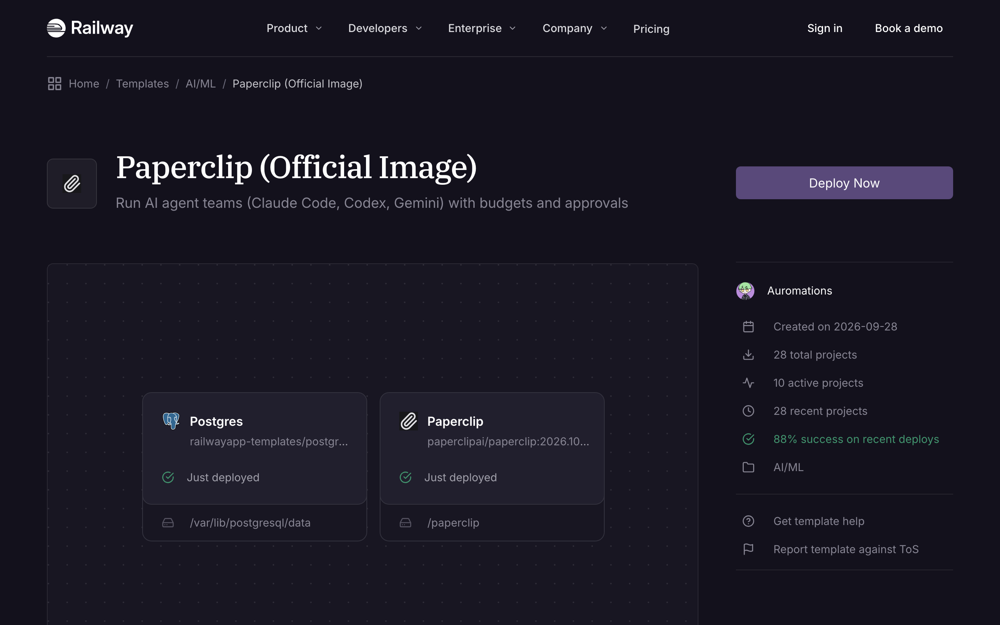

### 2. Open the URL and create an account

Open the Paperclip service's public URL (Railway shows it on the service card). Click **Sign in / Create account**, then **Create one**.

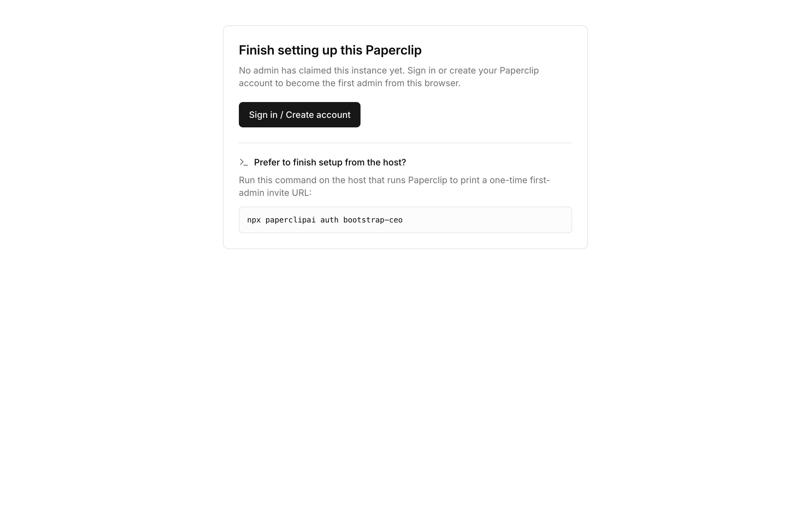

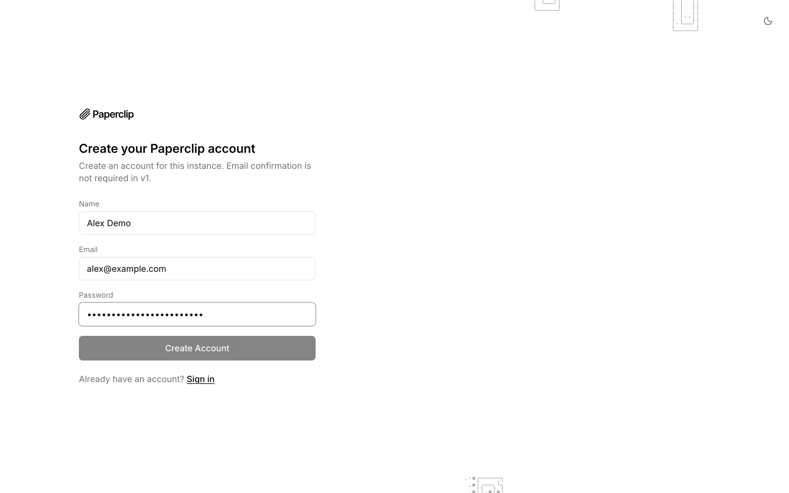

### 3. Claim the instance

Click **Claim this instance**. You are now the instance admin.

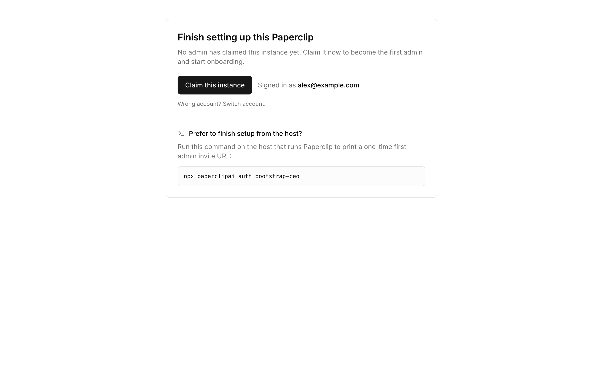

> **Do this immediately.** Until someone claims the instance, the first signed-in user on the URL becomes admin. After the claim, new sign-ups are normal accounts with no access to your companies.

### 4. Name your company and your first agent

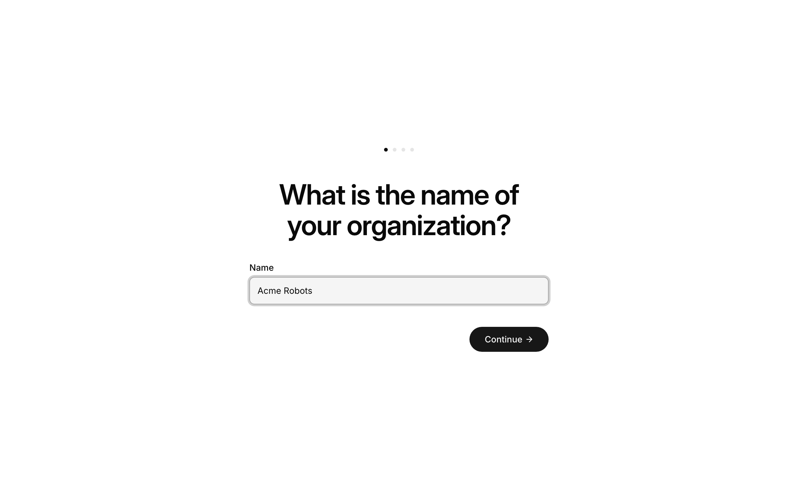

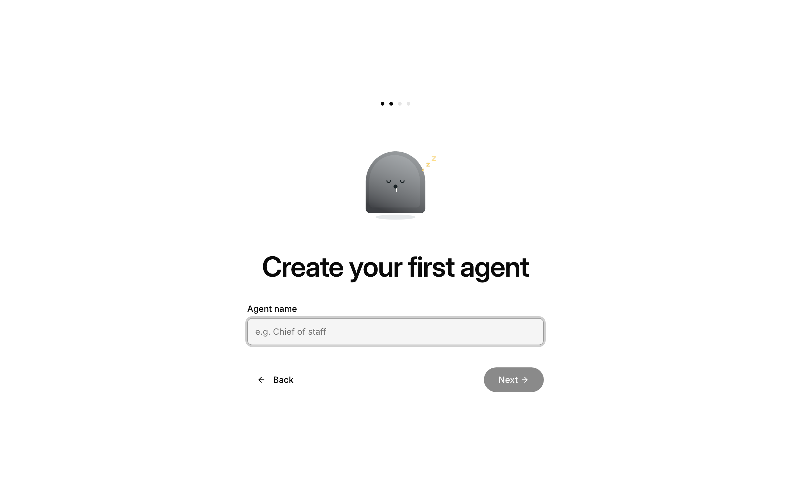

### 5. Connect a model

Paperclip asks how the agent signs in to a model. Pick one of the three options below.

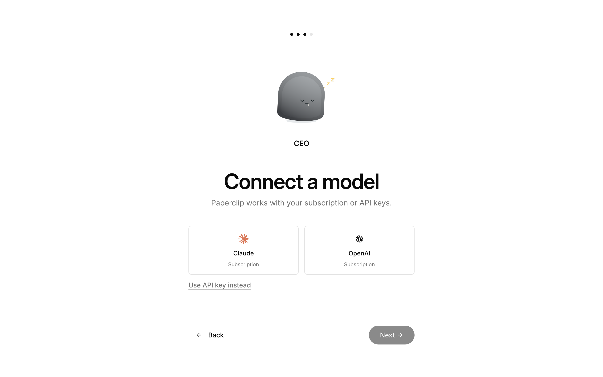

**Option A: API key (simplest).** Click **Use API key instead**, pick the provider, paste the key, and click **Connect**.

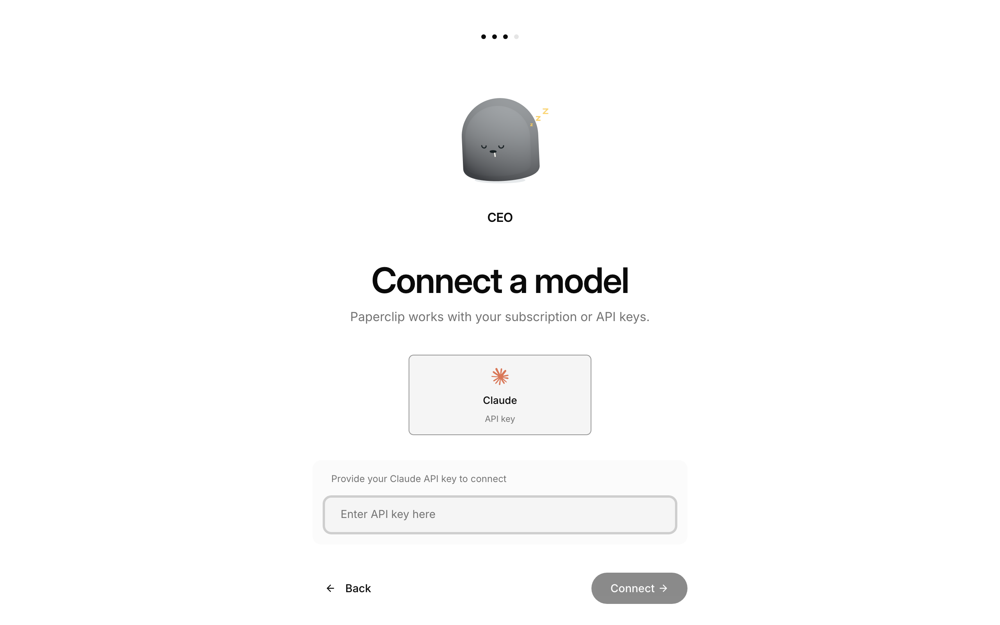

**Option B: Claude subscription (Pro or Max).** Paperclip runs `claude setup-token` on the server for you. This token lasts about one year, so it does not expire overnight.

1. Click **Claude**. Paperclip shows a **Sign in to Claude** link.
2. Open the link, sign in, and approve. Claude shows an authorization code.
3. Paste the code in **Paste authorization code here** and click **Submit code**.
4. Click **Connect**.

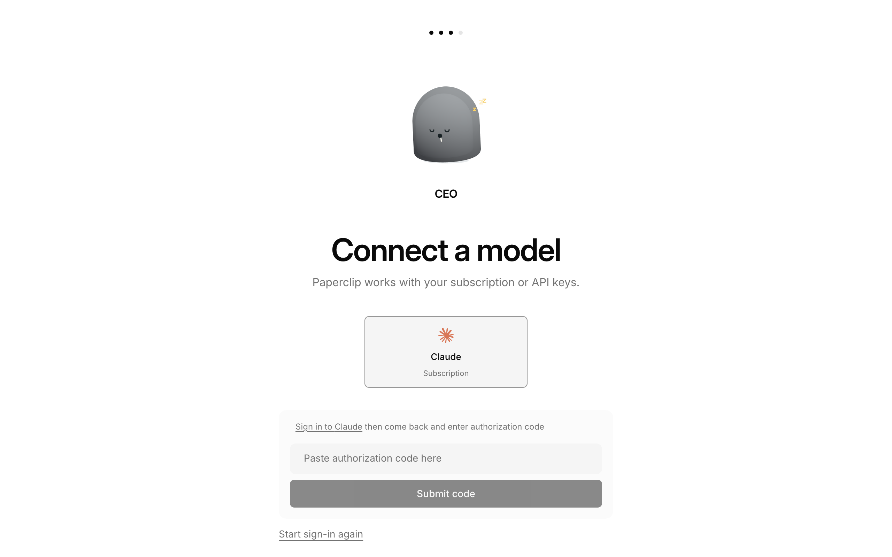

**Option C: ChatGPT subscription (Codex).**

1. Click **OpenAI**. Paperclip shows a one-time code.
2. Open the sign-in link, enter the code, and approve.
3. Click **Connect**.

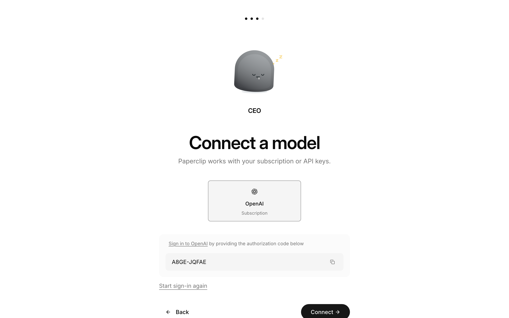

Use the code that Paperclip shows. On deploys made before 2026-11-10, the template's old `/connect` page can show a second Codex code. Do not use that one.

### 6. Give the agent a task

1. Click **Get started** to finish onboarding. Paperclip opens your company dashboard.
2. Click **New Task**, describe the work, and pick the agent and model at the bottom right.
3. Press the arrow button. The agent starts a run.

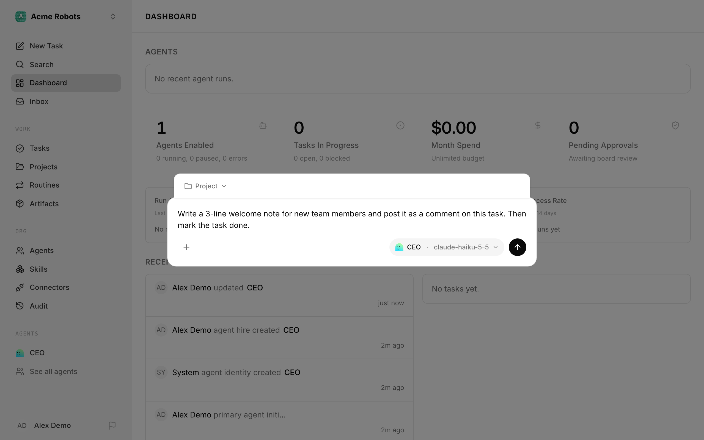

The agent posts its result on the task and marks it done. In this test, a CEO agent on `claude-haiku-5-5` finished a short writing task in about one minute.

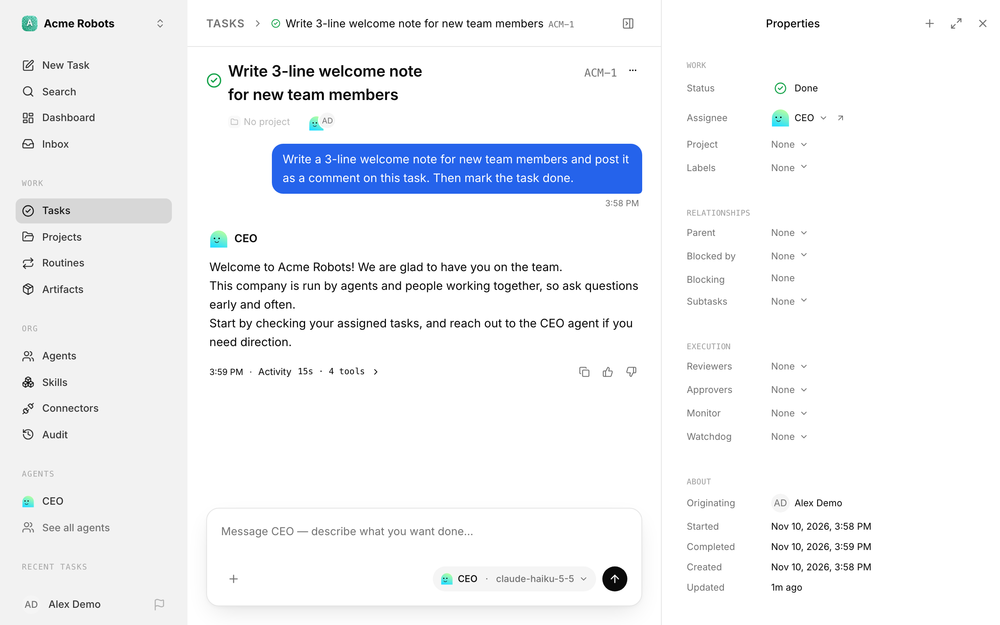

### 7. Invite your team

1. Open **Settings > Members > Invites**.
2. Choose a role (**Viewer**, **Operator**, **Admin** or **Owner**) and click **Create invite**. Paperclip copies the link to your clipboard.
3. Send the link to the teammate. Each link works once. The teammate gets the role after they sign in.

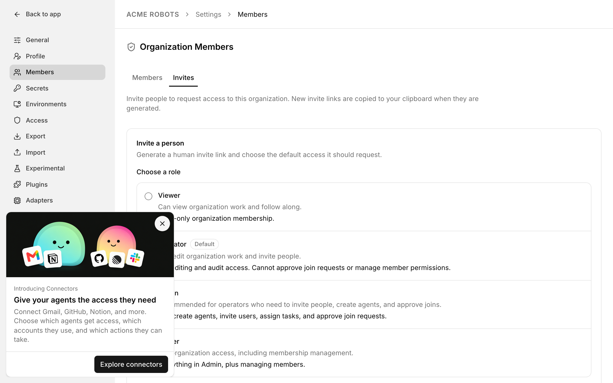

When everyone has joined, set `PAPERCLIP_AUTH_DISABLE_SIGN_UP=true` on the Paperclip service to stop new sign-ups.

## Variables you might change

| Variable | Default | When to change it |
|---|---|---|
| `PAPERCLIP_PUBLIC_URL` | `https://${{RAILWAY_PUBLIC_DOMAIN}}` | After you add a custom domain. Set it to that domain. |
| `PAPERCLIP_AUTH_DISABLE_SIGN_UP` | unset | Set to `true` to stop new sign-ups. |
| `HEARTBEAT_SCHEDULER_ENABLED` | `true` | Set to `false` to pause all agent heartbeats. |

Do not change `BETTER_AUTH_SECRET` after users exist. It signs every session, so a change logs everyone out.

## Newest Claude models

On each boot, the template installs the latest Claude Code onto the volume and points Paperclip's agents at it. If a new model is not in Paperclip's model list yet, type its full ID (for example `claude-opus-5-5`) in the **Model** box, choose **Use manual model**, and save.

## Upgrade

1. Pick a release from https://github.com/paperclipai/paperclip/releases.
2. On the Paperclip service, change the image tag to that release and redeploy.

Migrations apply on boot (`PAPERCLIP_MIGRATION_AUTO_APPLY=true`). Railway stops the old container before it starts the new one, so the volume is never shared by two versions.

## Troubleshooting

| Symptom | Cause | Fix |
|---|---|---|
| "Someone else has already claimed this instance" | Another account claimed it first. | If it was not you, delete the project, deploy again, and claim at once. |
| No **Claim this instance** button | The instance is already claimed. `/api/health` shows `"bootstrapStatus":"ready"`. | Sign in with the admin account. |
| The page shows `Loading…` and stops | The app is still starting, or the browser has an old session. | Wait 30 seconds and reload. If it continues, open `/auth` and sign in. |
| Health shows `database_backup_missing` just after deploy | The first backup has not run yet. | No action. It runs within the hour. |
| Agent fails to start | The agent has no model connection. | Connect one in the agent's settings (step 5). |
| Claude subscription stops working after some hours (401) | The agent uses a normal Claude login that expired. | Connect again with option B. It makes a long-lived setup token. |
| Code box says the code is wrong or expired | Each code works once and for a few minutes. | Click **Start sign-in again** and use the new link. |
| Two different Codex codes (Paperclip and `/connect`) | Deploys made before 2026-11-10 have an old `/connect` helper that also starts a sign-in. | Use the code in Paperclip and ignore `/connect`. To remove the helper, copy `CONNECT_HELPER_JS` from [`connect.mjs`](connect.mjs) into the Paperclip service variable and redeploy. |
| Agent process is killed, or the service restarts during runs | Not enough memory for the CLI. | Give the Paperclip service 2 GB RAM or more. |
| Sign-in links or redirects point to the wrong host | `PAPERCLIP_PUBLIC_URL` does not match the URL you use. | Set it to your custom domain, with `https://`. |

## Links

- Paperclip: https://github.com/paperclipai/paperclip
- Paperclip docs: https://docs.paperclip.ing/
- Template: https://railway.com/deploy/paperclip-official-1

---

## Maintainer files

| File | Purpose |
|---|---|
| `spec.py` | Services, variables, start command (single source of truth) |
| `build_source.py` | Creates the live source project |
| `apply_live.py` | Re-applies `spec.py` to the live source service |
| `connect.mjs` | Front proxy (port 3100), Claude Code / Codex launchers, `/connect` pointer page |
| `repair.py` | Restores literals stripped by `templateGenerate`, writes the template into Auromations, asserts read-back |
| `deploy_as_stranger.py` | `templateDeployV2` into a fresh project |
| `test/journey.sh <url>` | Browser claim, second-claim refusal, company CRUD, second-user isolation |
| `TEMPLATE_OVERVIEW.md` | Marketplace listing copy |
| `template.json` | Build sheet with rationale |
